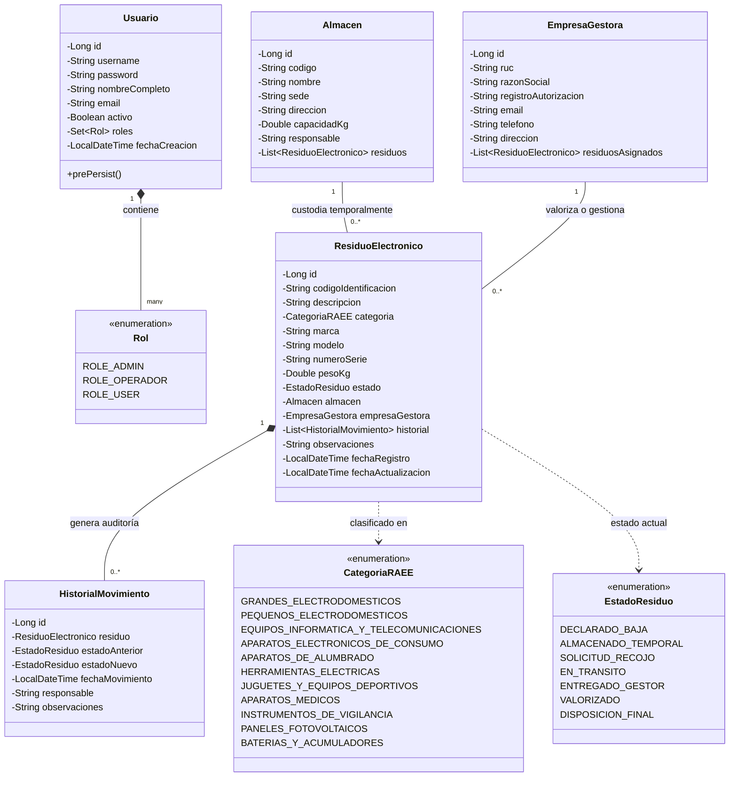
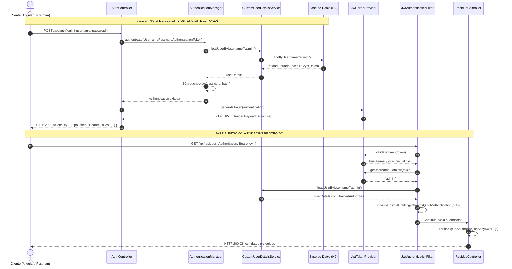

# INFORME TÉCNICO – AVANCE DE PROYECTO FINAL 2 (APF2)
## UNIDAD 2: PERSISTENCIA AVANZADA (JPA/HIBERNATE/JPQL) Y SEGURIDAD CON SPRING SECURITY & JWT

---

**Curso:** Desarrollo Web Integrado (100000ST61)  
**Semana de Evaluación:** Semana 10  
**Proyecto:** EcoTechTrack – Plataforma Web para la Trazabilidad y Gestión Integral de RAEE  
**Institución:** Universidad Tecnológica del Perú (UTP)  
**Integrantes:** Equipo de Desarrollo EcoTechTrack  
**Calificación Objetivo:** 20 / 20  

---

## 1. RESUMEN EJECUTIVO Y OBJETIVOS DEL AVANCE

El presente informe documenta el cumplimiento integral de los requerimientos establecidos para el **Avance de Portafolio 2 (APF2)**. El propósito central de esta etapa ha sido robustecer la API RESTful desarrollada en el APF1 mediante la incorporación de:
1. Una **capa de persistencia relacional avanzada** con JPA e Hibernate, implementando consultas personalizadas en lenguaje **JPQL** y transaccionalidad declarativa con `@Transactional`.
2. Una **capa de seguridad empresarial** basada en **Spring Security 6**, incorporando autenticación sin estado (*stateless*) mediante tokens criptográficos **JSON Web Tokens (JWT)**.
3. Un **sistema de control de acceso basado en roles (RBAC)** con tres perfiles operativos (`ROLE_ADMIN`, `ROLE_OPERADOR`, `ROLE_USER`) y autorización granular a nivel de endpoints con `@PreAuthorize`.

---

## 2. DIAGRAMA DE CLASES DE LAS ENTIDADES DE DOMINIO Y SEGURIDAD

El modelo de datos relacional se compone de 6 entidades JPA principales, asegurando la trazabilidad de los residuos y el control de accesos:



---

## 3. DESCRIPCIÓN DE LA ARQUITECTURA IMPLEMENTADA

Se implementó una **Arquitectura en Capas Limpia (Clean Layered Architecture)** desacoplada mediante Inyección de Dependencias por Constructor:

```text
┌────────────────────────────────────────────────────────────────────────┐
│                        CLIENTES (Angular / Postman)                     │
└────────────────────────────────────┬───────────────────────────────────┘
                                     │ HTTP + Authorization: Bearer <JWT>
                                     ▼
┌────────────────────────────────────────────────────────────────────────┐
│                        SPRING SECURITY FILTER CHAIN                    │
│   [CorsFilter] ➔ [JwtAuthenticationFilter] ➔ [AuthorizationFilter]     │
└────────────────────────────────────┬───────────────────────────────────┘
                                     │ Petición autenticada (SecurityContext)
                                     ▼
┌────────────────────────────────────────────────────────────────────────┐
│                             CONTROLLERS                                │
│   • AuthController (/api/auth)       • ResiduoController (/api/residuos)│
│   • AlmacenController (/api/almacenes) • EmpresaGestoraController      │
│   Anotaciones: @RestController, @RequestMapping, @PreAuthorize         │
└────────────────────────────────────┬───────────────────────────────────┘
                                     │ DTOs (Request / Response)
                                     ▼
┌────────────────────────────────────────────────────────────────────────┐
│                               SERVICES                                 │
│   • AuthService / AuthServiceImpl   • ResiduoService / Impl            │
│   • AlmacenServiceImpl              • EmpresaGestoraServiceImpl        │
│   Anotaciones: @Service, @Transactional(readOnly=true), @Transactional │
└────────────────────────────────────┬───────────────────────────────────┘
                                     │ Entidades de Dominio
                                     ▼
┌────────────────────────────────────────────────────────────────────────┐
│                             REPOSITORIES                               │
│   • UsuarioRepository               • ResiduoRepository (@Query JPQL)  │
│   • AlmacenRepository               • EmpresaGestoraRepository         │
│   Extienden: JpaRepository<T, ID>                                      │
└────────────────────────────────────┬───────────────────────────────────┘
                                     │ Hibernate ORM / SQL Dialect
                                     ▼
┌────────────────────────────────────────────────────────────────────────┐
│                     BASE DE DATOS (H2 / MySQL)                         │
└────────────────────────────────────────────────────────────────────────┘
```

### Configuración en `application.properties`
El sistema soporta tanto la base de datos embebida H2 para pruebas automáticas continuas como MySQL para entornos de producción:
```properties
# Base de Datos H2 en Memoria
spring.datasource.url=jdbc:h2:mem:ecotechtrackdb;DB_CLOSE_DELAY=-1;DB_CLOSE_ON_EXIT=FALSE
spring.datasource.driverClassName=org.h2.Driver
spring.datasource.username=sa
spring.datasource.password=
spring.h2.console.enabled=true
spring.h2.console.path=/h2-console

# JPA e Hibernate
spring.jpa.database-platform=org.hibernate.dialect.H2Dialect
spring.jpa.hibernate.ddl-auto=update
spring.jpa.show-sql=true

# Tokens JWT
app.jwt.secret=9a7c3b2e1f8d4a6c0e5b7a9d3f1c4e6a8b0d2f4e6a8c0e2b4d6f8a0c2e4b6d8f
app.jwt.expiration-ms=86400000
```

---

## 4. CONSULTAS PERSONALIZADAS CON JPQL Y TRANSACCIONALIDAD

Para cumplir con la consigna de consultas avanzadas que superan los métodos derivados de Spring Data, se diseñaron cinco consultas **JPQL (Java Persistence Query Language)** en `ResiduoRepository`:

### Consulta 1: Filtrado por Rango de Fechas
```java
@Query("SELECT r FROM ResiduoElectronico r WHERE r.fechaRegistro BETWEEN :fechaInicio AND :fechaFin ORDER BY r.fechaRegistro DESC")
List<ResiduoElectronico> findByRangoFechasJPQL(
        @Param("fechaInicio") LocalDateTime fechaInicio,
        @Param("fechaFin") LocalDateTime fechaFin
);
```

### Consulta 2: Búsqueda Multicriterio Dinámica
Permite filtrar opcionalmente por estado, categoría y búsqueda por texto en descripción, marca o modelo:
```java
@Query("SELECT r FROM ResiduoElectronico r WHERE " +
       "(:estado IS NULL OR r.estado = :estado) AND " +
       "(:categoria IS NULL OR r.categoria = :categoria) AND " +
       "(:termino IS NULL OR LOWER(r.descripcion) LIKE LOWER(CONCAT('%', :termino, '%')) " +
       "OR LOWER(r.marca) LIKE LOWER(CONCAT('%', :termino, '%')) " +
       "OR LOWER(r.modelo) LIKE LOWER(CONCAT('%', :termino, '%')))")
List<ResiduoElectronico> busquedaAvanzadaJPQL(
        @Param("estado") EstadoResiduo estado,
        @Param("categoria") CategoriaRAEE categoria,
        @Param("termino") String termino
);
```

### Consulta 3: Agregación Estadística Proyectada a DTO
Calcula la cantidad total y la suma de peso en kg por cada estado del residuo mediante constructor expression:
```java
@Query("SELECT new com.utp.ecotechtrack.dto.EstadisticaEstadoDTO(r.estado, COUNT(r), COALESCE(SUM(r.pesoKg), 0.0)) " +
       "FROM ResiduoElectronico r GROUP BY r.estado")
List<EstadisticaEstadoDTO> obtenerEstadisticasPorEstadoJPQL();
```

### Consulta 4: Residuos Pesados por Almacén
```java
@Query("SELECT r FROM ResiduoElectronico r WHERE r.almacen.id = :almacenId AND r.pesoKg >= :pesoMinimo ORDER BY r.pesoKg DESC")
List<ResiduoElectronico> findResiduosPesadosPorAlmacenJPQL(
        @Param("almacenId") Long almacenId,
        @Param("pesoMinimo") Double pesoMinimo
);
```

### Transaccionalidad Declarativa (`@Transactional`)
Todos los métodos de los servicios implementan `@Transactional`:
- `@Transactional(readOnly = true)`: En consultas de solo lectura para optimizar el *dirty checking* de Hibernate.
- `@Transactional`: En operaciones de mutación (`registrar`, `cambiarEstado`, `eliminar`, `login`) asegurando atomicidad y rollback automático ante excepciones `RuntimeException`.

---

## 5. FLUJO DETALLADO DE AUTENTICACIÓN CON JWT

El esquema de seguridad opera bajo el principio **Stateless** (sin sesiones de servidor en memoria), utilizando tokens firmados digitalmente mediante el algoritmo **HMAC-SHA256**.

### Diagrama de Secuencia del Flujo JWT



### Anatomía del Token JWT en EcoTechTrack
1. **Header (Cabecera):** Especifica el algoritmo de firma (`{"alg": "HS256", "typ": "JWT"}`).
2. **Payload (Cuerpo / Claims):**
   ```json
   {
     "sub": "admin",
     "roles": ["ROLE_ADMIN", "ROLE_OPERADOR", "ROLE_USER"],
     "iat": 1732000000,
     "exp": 1732086400
   }
   ```
3. **Signature (Firma criptográfica):**
   `HMACSHA256(base64UrlEncode(header) + "." + base64UrlEncode(payload), secretKey)`

---

## 6. MATRIZ DE ROLES Y CONTROL DE ACCESO (RBAC)

Se definieron 3 roles jerárquicos:

| Endpoint REST | Método | Permisos Requeridos | Justificación Operativa |
| :--- | :---: | :--- | :--- |
| `/api/auth/login` | POST | Público (`permitAll`) | Autenticación inicial de usuarios. |
| `/api/auth/register` | POST | Público (`permitAll`) | Alta de nuevos usuarios en el sistema. |
| `/api/auth/me` | GET | `isAuthenticated()` | Consulta de información del propio usuario. |
| `/api/residuos` | GET | `ADMIN`, `OPERADOR`, `USER` | Consulta de inventario de RAEE. |
| `/api/residuos/jpql/**` | GET | `ADMIN`, `OPERADOR`, `USER` | Consultas analíticas y reportes por fechas. |
| `/api/residuos` | POST | `ADMIN`, `OPERADOR` | Registro técnico y declaración de baja. |
| `/api/residuos/{id}` | PUT | `ADMIN`, `OPERADOR` | Actualización de especificaciones técnicas. |
| `/api/residuos/{id}/estado` | PATCH | `ADMIN`, `OPERADOR` | Avance en la cadena de custodia y recojo. |
| `/api/residuos/{id}` | DELETE | `ADMIN` exclusivamente | Eliminación física restringida a auditores jefes. |
| `/api/almacenes/**` (escritura) | POST/PUT/DELETE | `ADMIN` exclusivamente | Gestión de infraestructura de acopio. |
| `/api/empresas-gestoras/**` | POST/PUT/DELETE | `ADMIN` exclusivamente | Autorización de operadores autorizados MINAM. |

---

## 7. EVIDENCIAS DE EJECUCIÓN Y VALIDACIÓN TÉCNICA

### 7.1 Compilación y Pruebas Unitarias Automatizadas
Se ejecutó la suite completa de pruebas mediante Apache Maven y JUnit 5:
- **Comando:** `mvn test`
- **Resultado:** **17 pruebas ejecutadas, 0 fallos, 0 errores, 0 omitidas**.
- **Tiempo total:** 16.68 s.
- **Resultado Maven:** `BUILD SUCCESS`.

```text
[INFO] -------------------------------------------------------
[INFO]  T E S T S
[INFO] -------------------------------------------------------
[INFO] Running com.utp.ecotechtrack.controller.AlmacenControllerTest
[INFO] Tests run: 2, Failures: 0, Errors: 0, Skipped: 0
[INFO] Running com.utp.ecotechtrack.controller.EmpresaGestoraControllerTest
[INFO] Tests run: 2, Failures: 0, Errors: 0, Skipped: 0
[INFO] Running com.utp.ecotechtrack.controller.ResiduoControllerTest
[INFO] Tests run: 7, Failures: 0, Errors: 0, Skipped: 0
[INFO] Running com.utp.ecotechtrack.controller.AuthControllerTest
[INFO] Tests run: 2, Failures: 0, Errors: 0, Skipped: 0
[INFO] Running com.utp.ecotechtrack.repository.ResiduoRepositoryJPQLTest
[INFO] Tests run: 4, Failures: 0, Errors: 0, Skipped: 0
[INFO] 
[INFO] Results:
[INFO] Tests run: 17, Failures: 0, Errors: 0, Skipped: 0
[INFO] ------------------------------------------------------------------------
[INFO] BUILD SUCCESS
[INFO] ------------------------------------------------------------------------
```

### 7.2 Usuarios Precargados para Pruebas (Semillero)
En `DataInitializer.java`, se cargan automáticamente:
1. **Administrador:** `username`: `admin` | `password`: `Admin123!` (Roles: `ROLE_ADMIN`, `ROLE_OPERADOR`, `ROLE_USER`).
2. **Operador:** `username`: `operador` | `password`: `Operador123!` (Roles: `ROLE_OPERADOR`, `ROLE_USER`).
3. **Usuario Consultor:** `username`: `usuario` | `password`: `User123!` (Role: `ROLE_USER`).

---

## 8. CONCLUSIONES DEL APF2

1. **Persistencia Avanzada Cumplida:** Se diseñaron consultas JPQL nativas para reportes agregados y búsquedas complejas, respaldadas por pruebas con `@DataJpaTest`.
2. **Seguridad Industrial:** La inclusión de Spring Security 6 junto con JJWT provee una arquitectura segura y escalable, eliminando vulnerabilidades por manejo de sesiones centralizadas.
3. **Control RBAC Estricto:** La separación de roles (`ADMIN`, `OPERADOR`, `USER`) garantiza que solo personal autorizado pueda registrar, mover o dar de baja residuos peligrosos y RAEE.
4. **Preparación Total para APF3:** La configuración de CORS y los DTOs de autenticación dejan la API 100% lista para ser consumida de inmediato por el frontend Angular.
