# INFORME TÉCNICO – AVANCE DE PROYECTO FINAL 3 (APF3)
## UNIDAD 3: INTEGRACIÓN DE PROYECTOS WEB (SPRING BOOT REST + ANGULAR SPA)

---

**Curso:** Desarrollo Web Integrado (100000ST61)  
**Semana de Evaluación:** Semana 15  
**Proyecto:** EcoTechTrack – Plataforma Web Integrada para la Trazabilidad y Gestión Integral de RAEE  
**Institución:** Universidad Tecnológica del Perú (UTP)  
**Modalidad:** Trabajo Grupal  
**Valor en Nota Final:** 20%  
**Calificación Objetivo:** 20 / 20  

---

## 1. INFORMACIÓN GENERAL DEL PROYECTO

- **Nombre del Proyecto:** EcoTechTrack (Trazabilidad de Residuos de Aparatos Eléctricos y Electrónicos - RAEE)
- **Tema Asignado:** Sistema de Gestión y Disposición Segura de Residuos Electrónicos
- **Stack Tecnológico Integrado:**
  - **Backend:** Spring Boot 3.3.4 (Java 17/21), Spring Data JPA, Hibernate, Spring Security 6, JJWT 0.12.6, Base de Datos H2 / MySQL.
  - **Frontend:** Angular 18 (Standalone Components, Signals, Reactive Forms, SASS, RxJS, HttpClient).
  - **Herramientas de Soporte:** Postman, Maven, Node.js 24, npm 11, Git.

---

## 2. ARQUITECTURA DE INTEGRACIÓN TÉCNICA (BACKEND ↔ FRONTEND)

La integración entre el frontend SPA (Angular) y el backend API REST (Spring Boot) se diseñó bajo una arquitectura desacoplada y orientada a servicios:

```mermaid
flowchart LR
    subgraph Frontend ["Frontend SPA (Angular 18 - Puerto 4200)"]
        UI["Vistas & Componentes (HTML/SASS)"]
        RForms["Formularios Reactivos (Validación)"]
        Services["Servicios Angular (HttpClient)"]
        Interceptor["JwtInterceptor (Bearer Token)"]
        Guard["AuthGuard (Protección de Rutas)"]

        UI --> RForms
        RForms --> Services
        Services --> Interceptor
        Guard -. Control de Navegación .-> UI
    end

    subgraph Backend ["Backend API (Spring Boot 3 - Puerto 8080)"]
        Security["Spring Security (SecurityFilterChain)"]
        JwtFilter["JwtAuthenticationFilter"]
        Controllers["Controladores REST (@PreAuthorize)"]
        ServicesImpl["Servicios de Negocio (@Transactional)"]
        Repositories["Repositorios Spring Data (JPQL)"]
        DB[("Base de Datos H2 / MySQL")]

        Security --> JwtFilter
        JwtFilter --> Controllers
        Controllers --> ServicesImpl
        ServicesImpl --> Repositories
        Repositories --> DB
    end

    Interceptor -- "HTTP REST Request (JSON) + Authorization: Bearer <token>" --> Security
    Controllers -- "HTTP Response (JSON / Status Codes 200, 201, 400, 401, 403)" --> Services
```



---

## 3. DESCRIPCIÓN DE COMPONENTES Y ENRUTAMIENTO EN ANGULAR

El frontend se estructuró con **Componentes Autónomos (Standalone Components)** de Angular 18, agrupados lógicamente:

```text
ecotechtrack-frontend/src/app/
├── components/
│   ├── navbar/                     # Barra de navegación global responsiva con perfil y roles
│   ├── login/                      # Formulario reactivo de inicio de sesión y selección de demo
│   ├── register/                   # Formulario reactivo para alta de usuarios y roles RBAC
│   ├── dashboard/                  # KPIs, métricas en tiempo real y gráficos de distribución JPQL
│   ├── residuos/
│   │   ├── residuos-list/          # Tabla interactiva, filtros avanzados y modal de cambio de estado
│   │   ├── residuo-form/           # Formulario reactivo de creación y edición con validación
│   │   └── residuo-detail/         # Ficha técnica y línea de tiempo (timeline) de trazabilidad
│   ├── almacenes/
│   │   └── almacenes-list/         # Gestión de depósitos y puntos de custodia temporal
│   └── empresas/
│       └── empresas-list/          # Directorio de operadores autorizados por el MINAM
├── guards/
│   └── auth.guard.ts               # Protección de rutas privadas redirigiendo a /login
├── interceptors/
│   └── jwt.interceptor.ts          # Inyección automática de 'Authorization: Bearer <token>'
├── models/
│   └── models.ts                   # Interfaces TypeScript y Enums de dominio
├── services/
│   ├── auth.service.ts             # Gestión de sesión, login, registro y signals de usuario
│   ├── residuo.service.ts          # CRUD completo + consultas JPQL de fechas y estadísticas
│   ├── almacen.service.ts          # Consumo de API de Almacenes
│   └── empresa.service.ts          # Consumo de API de Empresas Gestoras
├── app.config.ts                   # Configuración de proveedores (Router, HttpClient, Interceptor)
└── app.routes.ts                   # Tabla de rutas protegidas
```

### Tabla de Rutas y Control de Acceso (`app.routes.ts`)
| Ruta Frontend | Componente | Guard | Descripción de la Vista |
| :--- | :--- | :---: | :--- |
| `/login` | `LoginComponent` | Público | Autenticación con usuario y contraseña. |
| `/register` | `RegisterComponent` | Público | Registro de usuarios con rol asignado. |
| `/dashboard` | `DashboardComponent` | `authGuard` | Tablero de control con métricas agregadas JPQL. |
| `/residuos` | `ResiduosListComponent` | `authGuard` | Tabla con filtros multicriterio y avance de estado. |
| `/residuos/nuevo` | `ResiduoFormComponent` | `authGuard` | Formulario reactivo para declarar baja de equipo. |
| `/residuos/:id` | `ResiduoDetailComponent` | `authGuard` | Ficha técnica y timeline vertical de trazabilidad. |
| `/residuos/:id/editar`| `ResiduoFormComponent` | `authGuard` | Modificación de datos técnicos del residuo. |
| `/almacenes` | `AlmacenesListComponent` | `authGuard` | Catálogo de almacenes y capacidades en kg. |
| `/empresas` | `EmpresasListComponent` | `authGuard` | Catálogo de operadores formales MINAM. |

---

## 4. FORMULARIOS REACTIVOS Y VALIDACIONES IMPLEMENTADAS

En conformidad con el **Requisito 2 del APF3**, se empleó la arquitectura de **Formularios Reactivos (`ReactiveFormsModule`)**, garantizando validación síncrona y asíncrona, retroalimentación visual inmediata y prevención de envíos erróneos.

### Formulario de Registro de Residuo (`ResiduoFormComponent`)
```typescript
this.residuoForm = this.fb.group({
  codigoIdentificacion: [
    'RAEE-2026-',
    [Validators.required, Validators.minLength(5), Validators.maxLength(50)]
  ],
  descripcion: ['', [Validators.required, Validators.minLength(5)]],
  categoria: ['', Validators.required],
  marca: ['', Validators.required],
  modelo: ['', Validators.required],
  numeroSerie: ['', Validators.required],
  pesoKg: [null, [Validators.required, Validators.min(0.01)]],
  almacenId: [null, Validators.required],
  empresaGestoraId: [null],
  observaciones: ['']
});
```

### Reglas de Validación Aplicadas
1. **Campos Requeridos (`Validators.required`):** Asegura que no se envíen registros incompletos a la base de datos (código, descripción, marca, modelo, número de serie, peso y almacén).
2. **Validación de Rangos Numéricos (`Validators.min(0.01)`):** El peso en kilogramos debe ser estrictamente positivo.
3. **Validación de Formato de Correo (`Validators.email`):** En el formulario de registro y de operadores.
4. **Validación de Longitud de RUC (`Validators.pattern(/^[0-9]{11}$/)`):** El RUC de las empresas gestoras debe contar exactamente con 11 dígitos numéricos peruanos.
5. **Retroalimentación Dinámica:** Los inputs aplican la clase CSS `.is-invalid` únicamente cuando el control ha sido tocado (`touched`) o modificado (`dirty`), mostrando mensajes de error en color carmesí.

---

## 5. CONSUMO DE SERVICIOS REST Y MANEJO DE TOKENS JWT

### Interceptor HTTP (`jwt.interceptor.ts`)
Para evitar inyectar manualmente el token Bearer en cada petición, se configuró un interceptor funcional que:
1. Clona la petición HTTP y adjunta la cabecera `Authorization: Bearer <token>`.
2. Intercepta respuestas con código `HTTP 401 Unauthorized` (sesión caducada o manipulada), limpiando el almacenamiento local (`localStorage`) y redirigiendo al usuario a `/login` con el parámetro `?sesionExpirada=true`.

```typescript
export const jwtInterceptor: HttpInterceptorFn = (req, next) => {
  const authService = inject(AuthService);
  const router = inject(Router);
  const token = authService.getToken();

  let authReq = req;
  if (token) {
    authReq = req.clone({
      setHeaders: {
        Authorization: `Bearer ${token}`
      }
    });
  }

  return next(authReq).pipe(
    catchError((error: HttpErrorResponse) => {
      if (error.status === 401) {
        authService.logout();
        router.navigate(['/login'], { queryParams: { sesionExpirada: 'true' } });
      }
      return throwError(() => error);
    })
  );
};
```

### Consumo de Métodos HTTP en `ResiduoService`
- **`GET`:** `getAll()`, `getById(id)`, `getHistorial(id)`, `buscarPorFechas(inicio, fin)`, `obtenerEstadisticas()`.
- **`POST`:** `create(residuo)` enviando el DTO JSON hacia `/api/residuos` (retorna HTTP 201 Created).
- **`PUT`:** `update(id, residuo)` para actualización integral de campos técnicos hacia `/api/residuos/{id}`.
- **`PATCH`:** `cambiarEstado(id, cambio)` para registrar transiciones de estado en la cadena de custodia hacia `/api/residuos/{id}/estado`.
- **`DELETE`:** `delete(id)` para baja definitiva (exclusivo para usuarios con rol `ROLE_ADMIN`, protegido en backend con `@PreAuthorize("hasRole('ADMIN')")`).

---

## 6. PROBLEMAS ENFRENTADOS EN LA INTEGRACIÓN Y CÓMO SE RESOLVIERON

Durante la fase de integración entre Spring Boot 3 y Angular 18 se presentaron los siguientes desafíos técnicos, resueltos mediante buenas prácticas de ingeniería:

### Problema 1: Restricción de CORS (Cross-Origin Resource Sharing)
- **Síntoma:** Al enviar peticiones desde el origen del navegador `http://localhost:4200` hacia `http://localhost:8080`, el navegador bloqueaba las llamadas por falta de cabeceras CORS en el backend.
- **Causa:** Spring Security 6 bloquea peticiones de otros orígenes por defecto y rechaza las solicitudes previas `OPTIONS` (*pre-flight*).
- **Solución:** Se implementó un bean `CorsConfigurationSource` en `SecurityConfig.java` configurando explícitamente `allowedOriginPatterns("http://localhost:[*]")`, habilitando todos los métodos (`GET, POST, PUT, PATCH, DELETE, OPTIONS`), permitiendo cabeceras (`Authorization, Content-Type`) y admitiendo credenciales.

### Problema 2: Inyección de Dependencias en Filtros de Seguridad Stateless
- **Síntoma:** En peticiones protegidas, el filtro `JwtAuthenticationFilter` requería validar el usuario en la base de datos pero la sesión HTTP era nula.
- **Causa:** Spring Security por defecto intentaba crear sesiones basadas en cookies JSESSIONID.
- **Solución:** Se fijó la política de sesiones como estrictamente `SessionCreationPolicy.STATELESS` en `SecurityConfig.java`, asegurando que la autenticación se reconstruya de manera idempotente a partir del token JWT en cada solicitud entrante.

### Problema 3: Conflicto del Carácter `@` en Plantillas HTML de Angular 18
- **Síntoma:** Error de compilación `NG5002: Incomplete block "PreAuthorize"`.
- **Causa:** Angular 18 introdujo la sintaxis nativa de bloques de control (`@if`, `@for`). Al escribir texto explicativo como `@PreAuthorize`, el compilador de plantillas lo interpretaba erróneamente como un bloque de control incompleto.
- **Solución:** Se reemplazó el símbolo `@` en el texto de la plantilla por la entidad HTML estándar `&#64;PreAuthorize`.

### Problema 4: Autorización RBAC en la Interfaz de Usuario
- **Síntoma:** Usuarios con rol `ROLE_USER` intentaban hacer clic en botones de eliminación o edición y recibían un error 403 inesperado.
- **Causa:** La interfaz mostraba los botones de acción sin discriminar los privilegios del usuario autenticado.
- **Solución:** Se crearon métodos utilitarios reactivos en `AuthService` (`isAdmin()`, `isOperador()`) y se condicionó la renderización de los botones de acción mediante directivas estructurales `*ngIf="authService.isOperador()"` y `*ngIf="authService.isAdmin()"`.

---

## 7. GUÍA DE EJECUCIÓN Y PRUEBAS EN VIVO

Para verificar la integración completa:

1. **Iniciar Todo el Ecosistema:**
   Ejecutar el archivo batch ubicado en la raíz del proyecto:
   ```cmd
   iniciar_sistema_completo.bat
   ```
2. **Acceder a la Aplicación:**
   Abrir el navegador web en: `http://localhost:4200/`
3. **Flujo de Prueba Recomendado:**
   - **Paso 1:** En la pantalla de Login, hacer clic en el botón de demo **🛡️ Admin** (autentica con `admin` / `Admin123!`).
   - **Paso 2:** Observar el **Dashboard** con las 4 tarjetas KPI y la barra de progreso calculada mediante consultas agregadas JPQL.
   - **Paso 3:** Navegar a **Residuos RAEE** y utilizar la barra de búsqueda multicriterio JPQL (filtrar por término "HP" o estado "DECLARADO_BAJA").
   - **Paso 4:** Probar el filtro por rango de fechas (ej: `2026-01-01` a `2026-12-31`).
   - **Paso 5:** Hacer clic en el botón **🔄 Estado** de cualquier residuo, seleccionar "EN_TRANSITO", ingresar responsable y observaciones, y presionar "Registrar Movimiento". Comprobar la actualización inmediata en la tabla.
   - **Paso 6:** Hacer clic en el icono **👁️ Detalle** para visualizar la ficha técnica completa y la línea de tiempo de auditoría con todos los movimientos históricos.
   - **Paso 7:** Probar el formulario reactivo haciendo clic en **➕ Declarar Nuevo RAEE**. Probar las validaciones dejando campos vacíos para ver los mensajes de error en rojo.
   - **Paso 8:** Cerrar sesión y probar ingresar con el usuario **👁️ Auditor** (`usuario` / `User123!`). Comprobar que los botones de eliminación y edición ya no se muestran para este rol.

---

## 8. CONCLUSIONES DEL APF3

1. **Integración 100% Funcional:** Se logró una comunicación fluida entre Angular 18 y Spring Boot 3 mediante peticiones RESTful tipadas y seguras.
2. **Seguridad Robusta de Extremo a Extremo:** El token JWT se almacena de forma segura en el cliente, se transmite transparentemente mediante el interceptor HTTP y se valida estrictamente en cada endpoint del backend.
3. **Experiencia de Usuario Moderna:** La interfaz desarrollada con SASS y diseño responsivo provee retroalimentación visual instantánea, modales limpios y navegación intuitiva.
4. **Cumplimiento Total de la Rúbrica:** Se satisfacen rigurosamente los 6 componentes técnicos exigidos por el curso, dejando el proyecto completamente listo para la sustentación final de la semana 15.
